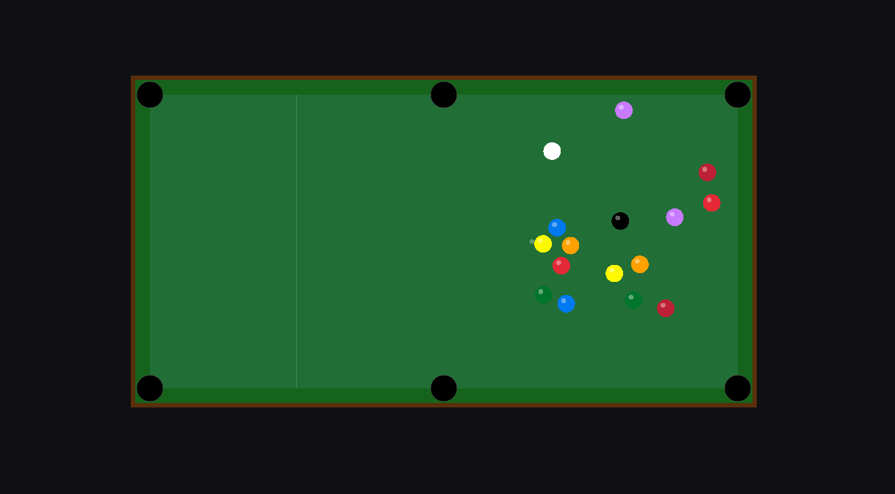

#+title: Cool Engine
#+AUTHOR: Alejandro Guzmán
#+DESCRIPTION: Un motor sencillo en C++, Raylib, Box2D y Lua scripting
#+LANGUAGE: es

** Descripción
Cool Engine es un proyecto pensado para el desarrollo sencillo y eficiente proporcionado por Raylib para juegos pequeños y multiplataforma. Con uso de C++ moderno y una arquitectura robusta alrededor de Lua como lenguaje de Scripting para gameplay.

** Características Principales
- Simple, multiplataforma, versátil.
- Utiliza C++ moderno en su justa medida donde es necesario para sumar a la arquitectura.
- Usa Lua como lenguaje de scripting; el motor tiene una clara diferenciación entre C++ (rápido y versátil para el núcleo) y Lua (simple, embebido y fácil de desarrollar para el gameplay).

** Tecnologías Utilizadas
- *Lenguajes:* =C++= / =Lua=
- *Frameworks:* =Raylib=, =Box2D=
- *Herramientas:* =CMake=

** Empezando (Getting Started)
Instrucciones paso a paso para que cualquier desarrollador pueda configurar el proyecto localmente sin problemas.

*** Requisitos Previos
- [[https://git-scm.com/][Git]]
- Compilador de C++ (GCC, Clang o MSVC)
- [[https://cmake.org/][CMake]] (versión 3.10 o superior)

*** Instalación
1. Clona el repositorio:
   #+BEGIN_SRC sh
   git clone https://github.com/AlexGuzmanSAE/Cool_Eng_Repo
   cd Cool_Eng_Repo/Cool_Engine
   #+END_SRC

2. Genera los archivos con CMake
   #+BEGIN_SRC sh
   mkdir build
   cd build
   cmake ..
   #+END_SRC

3. Compila el motor:
   #+BEGIN_SRC sh
   cmake --build .
   #+END_SRC

** Uso
Para ejecutar el motor (Linux) una vez compilado, desde la carpeta =build= ejecuta:

#+BEGIN_SRC sh
./Cool_EngineX
#+END_SRC

Ejemplo de cómo el motor expone la lógica a Lua (ejemplo de script de gameplay):
#+BEGIN_SRC lua
function Update(deltaTime)
    -- Lógica de movimiento procesada en Lua, renderizada en C++
    if Input.IsKeyDown(KEY_RIGHT) then
        player.x = player.x + (150 * deltaTime)
    end
end
#+END_SRC

** Arquitectura
El motor sigue una arquitectura basada en la separación de responsabilidades (*Core-Scripting*):
- *Núcleo (C++):* Se encarga de las tareas pesadas como el bucle principal, renderizado (Raylib), físicas (Box2D), gestión de memoria de bajo nivel y audio.
- *Gameplay (Lua):* Actúa como la capa superior. Permite a los diseñadores de niveles o programadores de gameplay iterar rápidamente sobre las reglas del juego, crear entidades e IA sin necesidad de recompilar el código fuente en C++.

** Licencia
Distribuido bajo la Licencia MIT. Consulta el archivo =LICENSE= para más detalles.

** Contacto
- *LinkedIn* - [[https://www.linkedin.com/in/alejandro-emiliano-guzm%C3%A1n-tejada-08b700267/][Linkedin Profile]]
- *Web Page* - [[https://alexguzmansae.github.io/portfolio/][PaginaWeb]]
